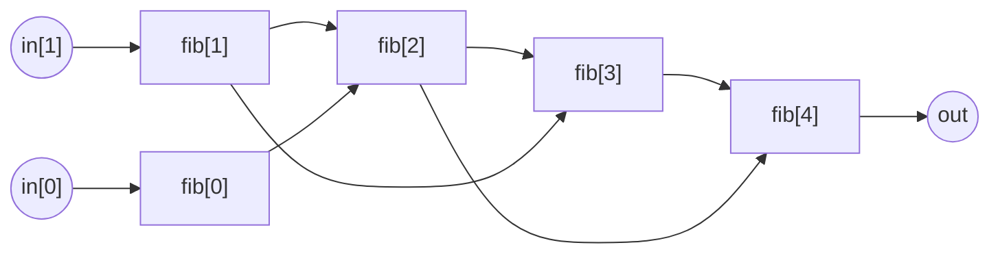

# Fibonacci

Calculating `n`'th Fibonacci number is yet another "Hello World!" of Circom. We simply constrain the starting numbers (given as input `in`) and assert the recurrence relation

$$a_n = a_{n-1} + a_{n-2}$$

## `Fibonacci`

```cs
{{#include ../../../../circuits/examples/simple/fibonacci.circom:Fibonacci}}
```

Here is how computing the 4'th Fibonacci number looks like:



> You can also implement Fibonacci recursively in Circom!
>
> ```cs
> template FibonacciRecursive(n) {
>   signal input in[2];
>   signal output out;
>
>   if (n <= 1) {
>     out <== in[n];
>   } else {
>     var prev = FibonacciRecursive(n-1)(in);
>     var prevprev = FibonacciRecursive(n-2)(in);
>     out <== prev + prevprev;
>   }
> }
> ```
>
> However, this is the "stupid" recursive way where we are not memoizing: every call creates two more components, so the number of components grows exponentially with `n`, just like the Fibonacci numbers themselves. That makes the circuit much larger and much slower to compile.

## Constraint Count

`Fibonacci(n)` has **0** non-linear constraints! Every step is an addition, i.e. a linear constraint, which is free. So no matter how large `n` is, this circuit costs nothing to prove, which is a nice reminder that only multiplications of signals have a cost.
