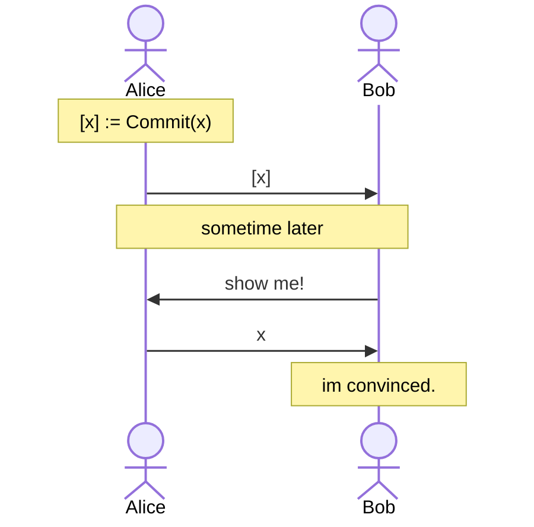

# Hashing

Hash functions are everywhere in zero-knowledge applications: commitments, Merkle trees, nullifiers, signatures, and so on. However, not all hash functions are equally good for circuits.

Traditional hash functions such as SHA-256 and Keccak are designed for CPUs: they work on bits and bytes, using operations like XOR, rotations and additions modulo $2^{32}$. In a circuit, every one of these bit operations costs constraints, as we must first decompose values into [bits](../bits/). In contrast, field additions and multiplications by constants are free, and multiplications of two signals cost one constraint each.

So, there are hash functions designed specifically for circuits, called **arithmetization-oriented** or **ZK-friendly** hash functions. They work natively with field elements, using only a small number of multiplications. Here is how they compare, in terms of non-linear constraints:

| Hash function                               | Input                    | Constraints |
| ------------------------------------------- | ------------------------ | ----------- |
| SHA-256 (`Sha256(512)` from Circomlib)      | 512 bits (64 bytes)      | 59281       |
| [MiMC](./mimc.md) (`MiMCSponge(2, 220, 1)`) | 2 field elements         | 1320        |
| [MiMC](./mimc.md) (`MultiMiMC7(2, 91)`)     | 2 field elements         | 728         |
| [Poseidon](./poseidon.md) (`Poseidon(2)`)   | 2 field elements         | 240         |

Note that two field elements hold about 508 bits, so Poseidon hashes about the same amount of data as SHA-256 above, with about 250 times fewer constraints! This is why Poseidon is the go-to hash function in Circom today.

## Commitments

One of the most common uses of hash functions is a **commitment scheme**. In a commitment scheme, Alice can commit to a value $x$ to obtain a commitment $\boxed{x}$. At some point later, Bob would like for Alice to reveal the committed value behind $\boxed{x}$, and show that indeed Alice was the one that had committed in the first place.

A rough informal sketch of this interaction can be shown as:



A cryptographic commitment scheme has two notable properties:

- **Hiding**: A commitment $\boxed{x}$ should reveal nothing about the underlying $x$.
- **Binding**: A commitment $\boxed{x}$, should only be revealed to $x$, i.e. for some $x' \ne x$ we shouldn't be able to compute a commitment $\boxed{x'} = \boxed{x}$.

A hash function gives us a simple commitment scheme: $\boxed{x} = H(x, r)$ where $r$ is a random number, also known as the _blinding factor_.

- It is **binding**, because opening the commitment to another $x'$ would require finding a collision of $H$.
- It is **hiding**, because $H$ does not reveal its inputs, and the random $r$ prevents anyone from simply trying all possible values of $x$. Without $r$, a commitment to a vote like $H(\text{yes})$ would be trivial to "decrypt" by comparing it with $H(\text{yes})$ and $H(\text{no})$!

In a circuit, we can prove that we know the opening of a commitment without revealing it. The commitment is public, while $x$ and $r$ are private:

```cs
template Commitment() {
  signal input x;          // the committed value, private
  signal input r;          // a random blinding factor, private
  signal input commitment; // public

  signal hash <== PoseidonHash(2)([x, r]);
  hash === commitment;
}
```

Of course, a circuit like this is more interesting when it also proves something _about_ $x$, e.g. that $x$ is within some range, without revealing $x$ itself.

A [Merkle tree](../merkle-trees/) is another commitment scheme built from a hash function, which commits to a whole list of values at once.
