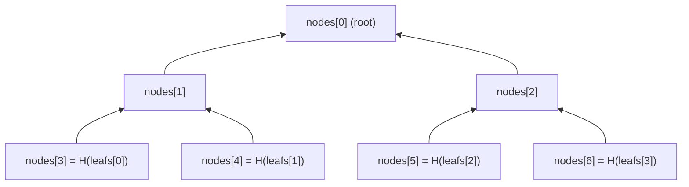

# Binary Merkle Tree

A **Binary Merkle Tree** is the most common kind of [Merkle Tree](./): every node has two children, and the tree is _dense_, i.e. it has exactly $2^n$ leaves for a tree of depth $n$, all of them filled. The tree of the vector `[m, y, v, e, c, t, o, r]` in the [introduction](./) is a Binary Merkle Tree of depth 3.

We have two circuits for it: one computes the root of the whole tree, and the other verifies a Merkle proof for a single leaf. Both use Circomlib's [Poseidon](../hashing/poseidon.md) as the hash function.

## `BinaryMerkleTree`

```cs
{{#include ../../../circuits/merkle-trees/bmt.circom:BinaryMerkleTree}}
```

This circuit takes all $2^n$ leaves, and computes the Merkle root. The nodes are stored in a single array `nodes` of size $2^{n+1} - 1$, in the same layout as a binary heap:

- the root is `nodes[0]`,
- the children of `nodes[i]` are `nodes[2i + 1]` and `nodes[2i + 2]`,
- the leaves are the last $2^n$ elements.

So we first hash each leaf into the last $2^n$ positions, and then fill in the rest of the array backwards, from the last internal node all the way to the root:



### Hashing Leaves & Nodes Differently

Notice that leaves are hashed with `Poseidon(1)` while internal nodes are hashed with `Poseidon(2)`. This is not just because a leaf is a single value: it also makes sure that a leaf can never be confused with an internal node.

Suppose we hashed the leaves and the nodes the same way, e.g. by not hashing the leaves at all. Then an internal node $h = H(a, b)$ could be presented as a "leaf" with value $h$, and its "proof" would just be the rest of the path above it. Someone could then prove that $h$ is in the tree, although $h$ was never one of the committed values. This is known as the [second-preimage attack](https://www.rareskills.io/post/merkle-tree-second-preimage-attack) on Merkle trees.

`Poseidon(1)` and `Poseidon(2)` use a different state size, and therefore different constants, so they behave like two unrelated hash functions. To pass off an internal node $h$ as a leaf hash, one would have to find an $x$ such that `Poseidon(1)(x) = h`, which is infeasible.

## `BinaryMerkleProof`

```cs
{{#include ../../../circuits/merkle-trees/bmt.circom:BinaryMerkleProof}}
```

Most of the time we do not want to give the whole tree to the circuit, but only prove that some value is in it. As described in the [introduction](./#merkle-proof), a Merkle proof consists of one sibling per level, and we compute the root by hashing our way up from the leaf.

At each level, we must know whether our node is the left or the right child, so that we hash the two children in the right order. This is given by `indices`: 0 if the sibling is on the right, and 1 if the sibling is on the left. The [`Switch`](../control-flow/) template then puts the two children in the correct order:

- `indices[i] = 0` gives `[path, sibling]`,
- `indices[i] = 1` gives `[sibling, path]`.

The circuit outputs the computed root, and it is up to the caller to compare it against a known (e.g. public) root.

### The Indices Must Be Bits

`Switch` does not check that its condition is a bit, and if it is not, the result is a mix of the two inputs:

$$
\text{out}_0 = \text{path} + (\text{sibling} - \text{path}) \cdot c \qquad \text{out}_1 = \text{sibling} - (\text{sibling} - \text{path}) \cdot c
$$

A dishonest prover can choose the sibling and $c$ so that these are _any_ two values that add up to `path + sibling`. In particular, at the top level, it can make them equal to the actual two children of the root, which gives the correct root for a leaf that is **not** in the tree! That is why we assert that each index is a bit with `AssertBit`, and our tests include such a forged proof to make sure that it is rejected.

### Indices from the Leaf Index

The indices are simply the bits of the leaf's position, from the most significant bit to the least significant one. For example, in a tree of depth 2, the leaf at position $2 = (10)_2$ is the left child of the right child of the root:

- at the top level, our node is on the right, so the sibling is on the left: `indices[0] = 1`
- at the bottom level, our node is on the left, so the sibling is on the right: `indices[1] = 0`

So instead of `indices`, one could take the position of the leaf as an input and decompose it with [`Num2Bits`](../bits/), which would also constrain the indices to be bits.

## Constraint Count

Each hash costs a few hundred constraints, so the hashes dominate the cost. With `Poseidon(1)` having 213 and `Poseidon(2)` having 240 constraints:

- `BinaryMerkleTree(n)` hashes $2^n$ leaves and $2^n - 1$ internal nodes, e.g. 1572 constraints for 4 leaves.
- `BinaryMerkleProof(n)` hashes one leaf and $n$ nodes, plus one `Switch` and one `AssertBit` per level: $213 + 242 \cdot n$ constraints. A tree of depth 20 has more than a million leaves, yet a proof for it takes only 5053 constraints.

## See Also

- [PSE zk-kit: Binary Merkle Root](https://github.com/privacy-scaling-explorations/zk-kit.circom/tree/main/packages/binary-merkle-root)
