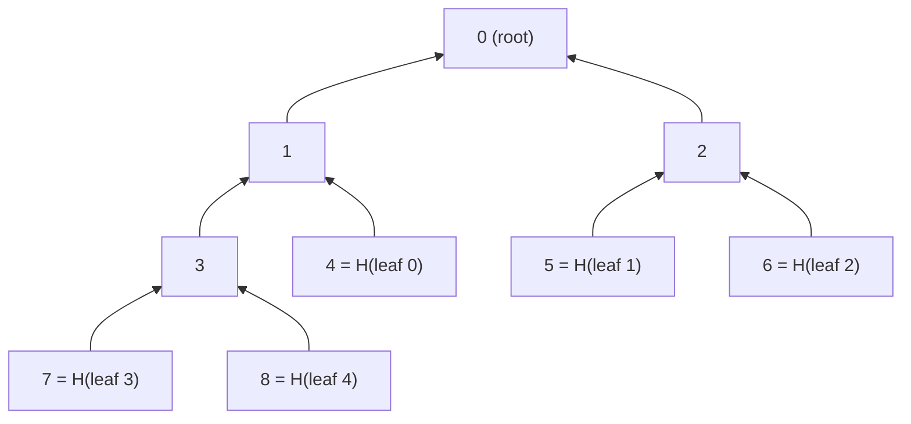

# Complete Binary Merkle Tree

A [Binary Merkle Tree](./bmt.md) must have exactly $2^n$ leaves. If we have, say, 5 values to commit to, we must pad them with 3 more to reach 8, which wastes space and hashes. A **Complete Binary Merkle Tree** solves this: it works with _any_ number of leaves $N$, using exactly $2N - 1$ nodes. It is used by [Nervos CKB](https://github.com/nervosnetwork/merkle-tree), for example.

The idea is to fill the tree level by level, just like a [binary heap](https://en.wikipedia.org/wiki/Binary_heap). The nodes are stored in an array where the root is at position 0, the children of the node at position $k$ are at $2k + 1$ and $2k + 2$, and the leaves are the last $N$ nodes. Here is the tree with 5 leaves:



Notice that the leaves are on the last two levels: leaves 0, 1 and 2 are at depth 2, while leaves 3 and 4 are at depth 3. This is the same layout as our [`BinaryMerkleTree`](./bmt.md#binarymerkletree), which is simply the special case $N = 2^n$, where all leaves are at the same depth.

## `CompleteBinaryMerkleTree`

```cs
{{#include ../../../circuits/merkle-trees/cbmt.circom:CompleteBinaryMerkleTree}}
```

Computing the root is exactly as in `BinaryMerkleTree`, only with $N$ leaves: hash the leaves into the last $N$ positions, then fill in the internal nodes backwards from position $N - 2$ down to the root. Our tests check that `CompleteBinaryMerkleTree(4)` gives the same root as `BinaryMerkleTree(2)`.

## `CompleteBinaryMerkleProof`

```cs
{{#include ../../../circuits/merkle-trees/cbmt.circom:cbmtDepth}}

{{#include ../../../circuits/merkle-trees/cbmt.circom:CompleteBinaryMerkleProof}}
```

A proof for a leaf is again its siblings from the leaf up to the root, but now the leaves can be at two different depths, so the number of siblings depends on the leaf. We use zk-kit's [`BinaryMerkleRoot`](./imt.md#membership-proofs) for this, which supports a variable depth up to a maximum: the maximum is the deepest level $D = \lfloor \log_2 (2N - 1) \rfloor$, and the siblings of a shallower leaf are padded with a 0.

The interesting part is to find the depth and the path of a leaf from its index, and it turns out that this is mostly linear. Number the nodes from 1 instead of 0, i.e. the root is 1, and the children of $j$ are $2j$ and $2j + 1$. In this numbering:

- The leaf with index $i$ is at position $j = N + i$.
- A node at depth $d$ has a position in range $[2^d, 2^{d+1})$. So the leaf is at the deepest level $D$ if $j \geq 2^D$, and at level $D - 1$ otherwise. A single `LessThan` finds out which one.
- The bits of $j$ describe the path from the root: after the leading 1, each bit is 0 for a left child and 1 for a right child. So $j - 2^d$, the index of the node within its level, has exactly the bits of the path, which is what `BinaryMerkleRoot` takes as its `index`.

For example, with $N = 5$, leaf 4 is at position $j = 9 = (1001)_2$, which is $\geq 2^3$, so it is at depth 3. Its index within the level is $9 - 8 = 1 = (001)_2$: from the root it goes left, left, then right, which is node 8 in the 0-based numbering of the figure above.

Since the depth is computed from the index instead of being given by the prover, the prover can not present an internal node as a leaf by choosing a smaller depth. We also make sure that the index is less than $N$, otherwise an index like $N$ would point to some other node of the tree.

## Constraint Count

| Circuit                               | Constraints |
| ------------------------------------- | ----------- |
| `CompleteBinaryMerkleTree(5)`         | 2025        |
| `CompleteBinaryMerkleProof(5)`        | 967         |
| `CompleteBinaryMerkleProof(1000000)`  | 5200        |

A proof for a million leaves has a depth of 20, and it costs about the same as a proof in a Binary Merkle Tree of depth 20, but without having to pad the leaves to $2^{20} = 1048576$.

## See Also

- [Nervos Network](https://www.nervos.org/)'s CBMT implementation: <https://github.com/nervosnetwork/merkle-tree>
