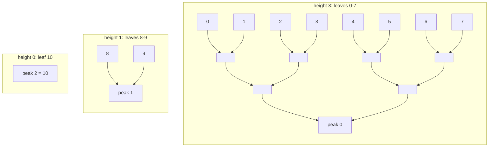

# Merkle Mountain Range

A **Merkle Mountain Range** (MMR) is an append-only commitment to a list of values that can grow forever. Unlike an [Incremental Merkle Tree](./imt.md), it has no fixed depth and no empty leaves. Instead, it is a list of perfect binary Merkle trees, called _mountains_, of decreasing heights. MMRs are used for append-only logs, such as committing to all block headers of a blockchain, e.g. by [HerodotusDev](https://www.herodotus.dev/) for storage proofs.

Here we use HerodotusDev's [accumulators](https://github.com/HerodotusDev/accumulators) library in our tests, with its Poseidon hasher which is the same as Circomlib's, and our circuit computes the very same root.

## Mountains

When a value is appended, it becomes a new mountain of height 0. Then, as long as the last two mountains have the same height, they are merged into one mountain that is one level higher, by hashing their peaks together. This is just like incrementing a binary counter, where a carry merges two mountains!

In fact, the mountains of an MMR with $n$ leaves correspond exactly to the bits of $n$: there is a mountain of height $h$ if and only if the bit $h$ of $n$ is set. For example, with $n = 11 = (1011)_2$ leaves there are three mountains, with 8, 2 and 1 leaves:



The total number of nodes, which HerodotusDev calls the _elements count_, is $2n - \text{popcount}(n)$, where $\text{popcount}(n)$ is the number of set bits in $n$, i.e. the number of peaks. For our example that is $22 - 3 = 19$.

## The Root

The peaks are combined into a single hash by _bagging_ them from right to left:

$$
\text{bag} = H(p_0, H(p_1, \ldots H(p_{k-2}, p_{k-1})))
$$

and the root of the MMR also commits to the elements count:

$$
\text{root} = H(\text{elementsCount}, \text{bag})
$$

With a single peak, the bag is just that peak. Note that a leaf is used as is, without hashing, just as in HerodotusDev's implementation.

## `MerkleMountainRangeProof`

```cs
{{#include ../../../circuits/merkle-trees/mmr.circom:MerkleMountainRangeProof}}
```

To prove that a leaf is in the MMR, we prove that it is in its mountain (a regular Merkle proof up to the peak), and that the root of the MMR is computed from all the peaks. The parameter `B` is the number of bits of the leaf count, so the circuit works for any MMR with less than $2^B$ leaves.

### Finding the Mountain

Which mountain is the leaf with index $i$ in? The mountains split the leaves into consecutive ranges according to the bits of $n$, from the highest bit to the lowest. So the leaf is in the mountain of height $h$, where $h$ is the **highest bit where $n$ and $i$ differ**. Since $i < n$, at that bit $n$ has a 1 and $i$ has a 0.

In our example with $n = 11 = (1011)_2$, the leaf $i = 9 = (1001)_2$ first differs from $n$ at bit 1, so it is in the mountain of height 1. Then:

- its index within the mountain is given by the lower bits of $i$, i.e. $(1)_2 = 1$: it is the right leaf of that mountain,
- its peak is the second one, as there is one set bit of $n$ above bit 1, i.e. one higher mountain.

In the circuit, `noneAbove[h]` tracks whether $n$ and $i$ are equal on all bits above $h$, and `isMountain[h]` is 1 only at the highest differing bit, if $n$ has a 1 there. We require exactly one `isMountain` to be 1, which also proves that $i < n$: if $i \geq n$, the highest differing bit (if any) would have a 1 in $i$ instead.

With `isMountain` as a selector, the height, the index within the mountain, and the index of the peak are all computed with one multiplication per bit. Then zk-kit's [`BinaryMerkleRoot`](./imt.md#membership-proofs) computes the peak from the leaf, with the height of the mountain as its depth, and we compare it with the selected peak from `peaks`.

### Bagging the Peaks

The number of peaks is the number of set bits of $n$, so it is not known at compile time. We compute the bag for every possible number of peaks, from right to left: `bags[j]` is the peak itself if it is the last one, the hash of the peak with `bags[j + 1]` if there are more peaks to its right, and 0 if it is not a peak at all. The `isLast` signals mark the last peak, and summing them from the right gives `isInner`, which tells whether there is a peak to the right.

Finally, the root is the hash of the elements count $2n - \text{popcount}(n)$ and `bags[0]`.

## Testing

Our tests build MMRs of different sizes with HerodotusDev's library, and check the proof of every leaf against the library's root (and the library's own proof verification). They also check that an index outside of the leaves, a wrong leaf, and swapped peaks are rejected, and that the root changes with the leaf count.

## Constraint Count

| Circuit                        | Constraints |
| ------------------------------ | ----------- |
| `MerkleMountainRangeProof(5)`  | 2252        |
| `MerkleMountainRangeProof(20)` | 9752        |

With `B = 20`, the MMR can have up to a million leaves. About half of the cost is the proof within the mountain, and the other half is bagging: since the number of peaks is not known at compile time, the circuit always computes `B - 1` hashes for it. If the verifier already knows the peaks, e.g. because they are public inputs, bagging could be done outside of the circuit, and only the peak of the leaf would need to be checked.

## See Also

- [HerodotusDev's Accumulators MMR](https://github.com/HerodotusDev/accumulators/tree/main/packages/merkle-mountain-range)
- [Grin's MMR documentation](https://github.com/mimblewimble/grin/blob/master/doc/mmr.md), which explains MMRs in more detail.
