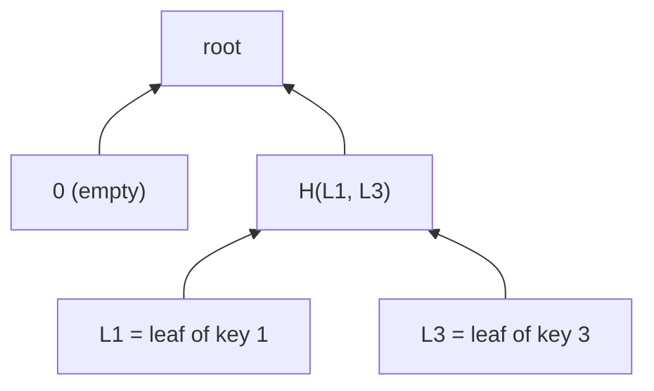

# Sparse Merkle Tree

A **Sparse Merkle Tree** is a Merkle tree that commits to a _key-value map_. Instead of placing the leaves one after the other, the position of each leaf is given by its key: the bits of the key tell us which way to go at each level, starting from the root. With 254-bit keys, the tree has $2^{254}$ possible positions, and almost all of them are empty, hence the name "sparse".

Since the position of a key is fixed, a Sparse Merkle Tree supports two kinds of proofs:

- **Inclusion proof:** a key is in the tree with some value, just like a membership proof.
- **Exclusion proof:** a key is **not** in the tree, by showing that its position is empty or occupied by another key. This is not possible with the other Merkle trees, where a leaf could be anywhere.

This makes them great for things like revocation lists, nullifier sets, or the state of a rollup. Circomlib has circuits for Sparse Merkle Trees, designed by Iden3 (see the [paper](https://docs.iden3.io/publications/pdfs/Merkle-Tree.pdf)), and [circomlibjs](https://github.com/iden3/circomlibjs) has a matching TypeScript implementation which we use in our tests.

## Compressing the Tree

A tree of depth 254 would require 254 hashes for every proof, which is way too many. So Circomlib compresses the tree: **a subtree that contains only one leaf is replaced by that leaf**. In other words, a leaf is placed at the highest level where it is alone, instead of at the very bottom.

As an example, consider a tree with the keys 1 and 3. The bits of the keys are read starting from the least significant one, and 0 means left while 1 means right:

- Both keys have the lowest bit set ($1 = (01)_2$ and $3 = (11)_2$), so both go to the right of the root, and the left of the root is empty.
- Their second bit differs, so at the next level 1 goes to the left and 3 goes to the right, and now each of them is alone.



So the root is $H(0, H(L_1, L_3))$, using just two levels. With $k$ random keys, the leaves are at a depth of about $\log_2 k$ on average. A tree with a single key is just that leaf, and an empty tree has the root 0.

### Leaves

A leaf contains both the key and the value: $L = H(\text{key}, \text{value}, 1)$, using `Poseidon(3)`. Including the key is important, since a leaf can now be at any level, and its position alone does not tell us its full key. The extra 1 separates leaves from internal nodes, which are hashed with `Poseidon(2)`.

## `SMTVerifier`

The circuit for both kinds of proofs is `SMTVerifier(nLevels)`, where `nLevels` is the maximum depth of a leaf. It has the following inputs:

- `root`: the root of the tree.
- `siblings`: the siblings from the root down to the leaf, padded with zeros up to `nLevels`.
- `key` & `value`: the key, and its value for an inclusion proof.
- `fnc`: 0 for an inclusion proof, 1 for an exclusion proof.
- `oldKey`, `oldValue` & `isOld0`: for an exclusion proof, either the position of `key` is empty (`isOld0 = 1`), or it holds the leaf of another key `oldKey` with value `oldValue`.
- `enabled`: if 0, the circuit does not check anything. This is useful when the proof is optional, e.g. within a batch.

Using our example tree:

| Proof                    | `siblings`        | Notes                                                      |
| ------------------------ | ----------------- | ---------------------------------------------------------- |
| key 1 is in the tree     | $[0, L_3]$        | `fnc = 0`                                                  |
| key 2 is not in the tree | $[H(L_1, L_3)]$   | $2 = (10)_2$ goes to the left of the root, which is empty: `isOld0 = 1` |
| key 5 is not in the tree | $[0, L_3]$        | $5 = (101)_2$ goes right, then left, where it finds key 1: `oldKey = 1` |

### Levels & States

How does the circuit know where the leaf is? Since the siblings are padded with zeros, the leaf is right below the last non-zero sibling. The `SMTLevIns` template finds this level, and requires the very last sibling to be zero, so that the tree is never deeper than `nLevels`.

Then, each level is in one of the following states, given by a small state machine (`SMTVerifierSM`):

- `top`: above the leaf, where we hash the child with the sibling,
- `inew`: the level of the leaf, for an inclusion proof, i.e. the leaf $H(\text{key}, \text{value}, 1)$,
- `iold`: the level of the leaf, for an exclusion proof with another key, i.e. the leaf $H(\text{oldKey}, \text{oldValue}, 1)$,
- `i0`: the level of the leaf, for an exclusion proof with an empty position, i.e. 0,
- `na`: below the leaf, where there is nothing to compute.

Each level then computes its node based on its state:

```cs
template SMTVerifierLevel() {
    signal input st_top;
    signal input st_i0;
    signal input st_iold;
    signal input st_inew;
    signal input st_na;

    signal output root;
    signal input sibling;
    signal input old1leaf;
    signal input new1leaf;
    signal input lrbit;
    signal input child;

    signal aux[2];

    component proofHash = SMTHash2();
    component switcher = Switcher();

    switcher.L <== child;
    switcher.R <== sibling;

    switcher.sel <== lrbit;
    proofHash.L <== switcher.outL;
    proofHash.R <== switcher.outR;

    aux[0] <== proofHash.out * st_top;
    aux[1] <== old1leaf*st_iold;

    root <== aux[0] + aux[1] + new1leaf*st_inew;
}
```

Since exactly one of the state signals is 1, the result is either the hash of the child and the sibling (ordered by the key bit `lrbit`, using a `Switcher`), the old leaf, the new leaf, or 0 (for `i0` and `na`). The node of the top level is then compared with `root`.

### Checking the Keys

There are two more important checks in `SMTVerifier`:

- The keys are decomposed into bits with `Num2Bits_strict`, which also performs an [alias check](../comparators/constant.md#aliascheck). Otherwise, a key and the key plus $p$ would have different bits, and thus different positions in the tree.
- For an exclusion proof with another key, `oldKey` must be different from `key`. Otherwise, one could "prove" that a key is not in the tree by using its own leaf as the "other" leaf, which our tests check as well.

## `SMTProcessor`

Circomlib also has `SMTProcessor(nLevels)`, which proves that a change to the tree turns `oldRoot` into `newRoot`, similar to the [insertion proof](./imt.md#insertion-proofs) of an Incremental Merkle Tree. The operation is given by two bits `fnc`:

| `fnc`    | Operation |
| -------- | --------- |
| `[0, 0]` | nothing   |
| `[1, 0]` | insert    |
| `[0, 1]` | update    |
| `[1, 1]` | delete    |

It works with the same siblings for the old and the new tree. An insertion is a bit tricky though: if the position of the new key holds another leaf, that leaf must be pushed down until the two keys go different ways, which adds new levels to the tree. Our tests use circomlibjs to insert, update and delete keys, and check that `SMTProcessor` computes the same new roots.

## Constraint Count

| Circuit            | Constraints |
| ------------------ | ----------- |
| `SMTVerifier(10)`  | 4063        |
| `SMTVerifier(20)`  | 6573        |
| `SMTProcessor(20)` | 11535       |

Each level costs about 251 constraints, most of which is the `Poseidon(2)` hash. On top of that, there is a fixed cost of about 1550 constraints for the two leaf hashes and the two 254-bit key decompositions with alias checks.

## See Also

- [Tochicool's SMT](https://github.com/tochicool/sparse-merkle-trees#readme)
- [Efficient Sparse Merkle Trees](https://eprint.iacr.org/2016/683.pdf) by Rasmus Dahlberg, Tobias Pulls, and Roel Peeters.
- Iden3 (authors of Circom) has a nice publication on Merkle Trees: [Sparse Merkle Trees](https://docs.iden3.io/publications/pdfs/Merkle-Tree.pdf) by Jordi Baylina and Marta Belles.
